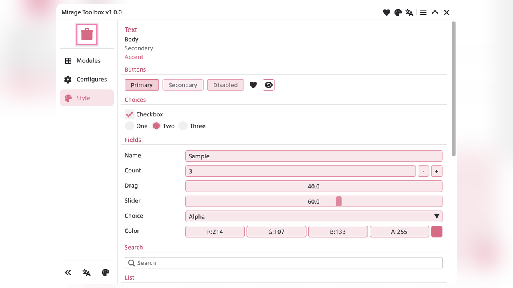

# MirageUI

[Japanese](README.ja.md)



An ImGui-based UI library for Dalamud plugins. It manages text rendering, theming, window structures, and two-column layouts. The current version is 2.0.0.

**Public API names start with `Mirage`.**

```csharp
global using MirageUI;
global using static MirageUI.Ui.MirageLayout;  // Style, Cursor, etc.
```

## Contents

- [Setup](#setup)
- [Window](#window)
- [Plugin Page](#plugin-page)
- [Language](#language)
- [Two Columns](#two-columns)
- [Widgets](#widgets)
- [Theme](#theme)
- [Layout](#layout)

## Setup

First, pass color settings via `ConfigureTheme`, then call `Init`. `Init` prepares fonts, images, MirageUI strings, and the plugin page. Pass `ITextureProvider` when using `Image`.

```csharp
using Dalamud.Plugin;
using Dalamud.Plugin.Services;
using MirageUI;
using MirageUI.Theme;

public sealed class Plugin : IDalamudPlugin
{
    public Plugin(IDalamudPluginInterface pluginInterface, ITextureProvider textureProvider, IPluginLog log)
    {
        MirageUi.ConfigureTheme(() => MirageColorSettings.CreateDefault());
        MirageUi.Init(pluginInterface, textureProvider, log);
    }

    public void Dispose()
    {
        MirageWindowCapture.Dispose();
        MirageUi.Dispose();
    }
}
```

In the window, apply colors before drawing and restore them afterward. Copy the screenshot in `PostDraw`.

```csharp
public override void PreDraw() =>
    _colorScope = MirageTheme.PushCustom(MirageTheme.ResolveAppliedColors());

public override void PostDraw()
{
    MirageWindowCapture.Copy();
    MirageTheme.Pop(_colorScope);
}
```

## Window

`MirageWindowHeader` renders the title bar and the left rail. The menu, collapse, close, and rail expand buttons remain fixed. Any other button can be added as a `MirageWindowFeature`.

Page entries are provided as a `Section` list in the order specified. This list is separate from the feature buttons.

```csharp
var sections = new MirageWindowHeader.Section[]
{
    new("modules", "Modules", FontAwesomeIcon.ThLarge),
};

var features = new MirageWindowFeature[]
{
    new()
    {
        Id = "plugin",
        PageId = "plugin",
        Icon = FontAwesomeIcon.Heart,
        ShowOnTitle = true,
        TitleKind = MirageWindowFeatureKind.OpenPage,
        TitleOrder = 0,
    },
};

var rail = MirageWindowHeader.RailWidth(railCollapsed, sections, features);
MirageWindowHeader.Draw(this, title, ref collapsed, leftInset: 0f, ref pageId, features);
MirageWindowHeader.DrawRail(sections, ref pageId, ref railCollapsed, showSections: !collapsed, features);
```

Configure each feature using the fields below:

| Field | Description / Value |
| --- | --- |
| Page | Set `PageId`. If empty, no page is associated |
| Title | `ShowOnTitle`. `TitleKind` can be `OpenPage` or `Shortcut` |
| Title footer | When set to `Shortcut` and `TitleOpensPage` is enabled, shows a row that opens the settings page |
| Rail | `ShowOnRail`. `RailWhen` can be `Collapsed`, `Expanded`, or `Both` |
| Rail kind | `RailKind` |
| Rail footer | When set to `Shortcut` and `RailOpensPage` is enabled, shows a row that opens the settings page |

`OpenPage` and the footer apply only when `PageId` is set. Opening a page from the title bar expands the window, whereas opening it from the rail only updates the active selection.

Display order is determined by `TitleOrder` and `RailOrder`. Smaller numbers appear first. Equal values preserve the order in which they were passed. Provide an `Icon` if the button should be displayed. Render shortcut popup content using `DrawPopup`, specify width with `PopupTextWidth`, and draw each row with `MirageWindowHeader.PopupRow`.

Rail labels can be omitted. If all labels are empty, icons are arranged in a single horizontal row. If any label is present, buttons are stacked vertically. While collapsed, only the icons are displayed vertically in the same order.

Dalamud's IconFont only supports Font Awesome Free Solid. Brand icons are not supported.

## Plugin Page

`Init` automatically populates the name, author, version, GitHub URL, and `Data/plugin-icon.png` from the plugin manifest. Additional details like the message, Discord, and Support URLs can be configured using `ConfigurePluginInfo`. Empty rows are omitted.

The default page centers the name, version, `by author`, message, and links. When `Data/plugin-icon.png` is present, the icon is centered above them. When it is missing, that space is omitted. By passing a custom draw callback to `SetPluginPage`, `DrawPluginPage` will render the entire page using that callback. Pass `null` to restore the default layout.

Without the image, the left rail mark uses `TitleBarIcon`. The default is `FontAwesomeIcon.Heart`. Set another icon through `ConfigurePluginInfo`.

The two-column overlay opened by `TogglePluginPage` or `OpenPluginPage` does not use `SetPluginPage`. It draws the default page.

```csharp
MirageUi.ConfigurePluginInfo(info =>
{
    info.Message = "Short note.";
    info.DiscordUrl = "https://discord.example";
});

MirageUi.SetPluginPage(() =>
{
    MirageUi.Header("Plugin");
});
```

## Language

Supports English and Japanese. `SetLanguage` selects Japanese only when the language code starts with `ja`; any other code defaults to English. This setting does not automatically follow Dalamud's language configuration.

`Init` loads the built-in MirageUI strings. Register your plugin's strings afterward using `Register` or `RegisterEmbedded`. If duplicate keys exist, the latest value takes precedence. If a Japanese key is missing, it falls back to English. If the English key is also missing, the key itself is returned.

Logical names for embedded resources should follow `{prefix}.en.json` and `{prefix}.ja.json`.

```csharp
MirageUi.I18n.SetLanguage("ja");
MirageUi.I18n.RegisterEmbedded(typeof(Plugin).Assembly, "MyPlugin.Localization");
var label = MirageUi.I18n.Get("nav.modules");
```

## Two Columns

The layout consists of a sidebar on the left and main content on the right. `MirageTwoColumnState` controls the layout content and visibility.

```csharp
using MirageUI.Layout;

var state = new MirageTwoColumnState
{
    ShowSearch = true,
    ShowEntryToggle = true,
    Entries =
    [
        new MirageTwoColumnEntry { Id = "settings", Label = "Settings", Enabled = true },
    ],
    SelectedId = "settings",
    OnSelectionChanged = id => { },
    OnEnabledChanged = (id, enabled) => { },
};

MirageUi.TwoColumn.Draw(state, () =>
{
    MirageUi.Header("Details");
});
```

| Property | Default | Description |
| --- | --- | --- |
| `ShowSidebar` | `true` | Toggles the left column. Setting to `false` expands the right column to full width |
| `ShowSearch` | `false` | Shows the search bar at the top of the sidebar |
| `ShowEntryToggle` | `false` | Shows a checkbox on each entry |
| `SidebarWidth` | `304` | Width of the left column |
| `SearchHint` | empty | Placeholder text (defaults to MirageUI's "Search" when empty) |
| `SearchTrailingActions` | empty | Icon buttons placed between the search field and `×` |
| `SearchFilter` | empty | Filter query string |
| `AutoSelectFirstOnSearch` | `true` | Automatically selects the first matching item when typing. Clearing the filter keeps the current selection |
| `OnSearchFilterChanged` | null | Receives the search text each time the search bar is drawn |

The search bar layout is `[search][×]`. When `SearchTrailingActions` is set, it becomes `[search][buttons] | [×]`. Clicking `×` collapses the sidebar. The magnifying glass icon is displayed on the left. Search matches are case-insensitive substrings of either the ID or the label. While filtering, matching folders automatically expand, and entry reordering is disabled.

An entry may set `LabelColor` and `ContextMenuItems`. A right click selects that entry and opens the menu. `SidebarNodes` accepts a folder or a single page entry. `AlwaysExpanded` keeps a folder open. When `EnableEntryReorder` is set, dragging an entry reorders it within its folder, or within the flat list. The new index is passed to `OnEntryReordered`.

Only the entry list scrolls. The search bar stays fixed.

## Widgets

### Text

| Method | Description | Default Color | Default Size |
| --- | --- | --- | --- |
| `Header` | Large heading | `Color.Title` | `FontSize.Large` |
| `HeaderWithBool` | Heading with an ON/OFF toggle on the right | `Color.Title` | `FontSize.Large` |
| `HeaderWithRunToggle` | Heading with a Start/Stop toggle on the right | `Color.Title` | `FontSize.Large` |
| `SubHeader` | Small heading | `Color.Title` | `FontSize.Default` |
| `Text` | Regular body text | `Color.Default` | `FontSize.Default` |

`MirageUi.Color` options include `Default`, `Secondary`, `Accent`, `Title`, `Warning`, and `PanelOverlay`.

### Button

`Primary` uses a prominent accent color, while `Secondary` is more muted. Setting `width` to `0` automatically sizes the button to its label; setting it above `0` creates a fixed-width button.

| API | Description |
| --- | --- |
| `Button(label, kind, ...)` | Renders a button of type `Primary` or `Secondary` |
| `PrimaryButton` / `SecondaryButton` | Shorthand methods for `Button` |

### Dropdown

A dropdown row fills the available content width. The widths for the left label and the right control can be customized independently. The label defaults to a width of 128, and the control fills the remaining space.

| API | Description |
| --- | --- |
| `Dropdown(label, ref selected, items, ...)` | Standard string list dropdown |
| `SearchableDropdown(..., ref searchFilter, ...)` | Dropdown with a search filter |
| `BeginDropdown` / `EndDropdown` | Custom item rendering block |
| `DropdownItem(label, selected)` | Single item row (selected item automatically gains focus) |
| `labelWidth` / `width` | Setting either side to `<= 0` causes it to stretch automatically |

Duplicate labels cannot be distinguished as unique selections. Disambiguate them using the `label##id` syntax.

### Input

Shares the same layout structure as Dropdown.

| API | Description |
| --- | --- |
| `InputText` | Text input (`hint` sets the placeholder text) |
| `InputInt` / `InputFloat` | Numeric input |
| `DragInt` / `DragFloat` | Draggable numeric field |
| `SliderInt` / `SliderFloat` | Slider control |
| `InputWidthFill` | Expands the control to fill the right column |

### Images and Icons

| API | Description |
| --- | --- |
| `Image(path, width, height, ...)` | Loads a local image file. Returns `false` if loading fails |
| `GameIcon(iconId, width, height, ...)` | Renders an in-game icon |
| `TryGetGameIcon` | Retrieves the icon texture directly |
| `IconButton` | Icon button (border disabled by default) |
| `IconToggleButton` | Toggleable two-state button (border enabled by default) |
| `IconChecklistButton` | Opens a checklist menu |
| `IconToolbar` | Single-row toolbar combining filter, sort, and search |
| `IconLabelToggleGrid` | Grid of icon and label toggle tiles |
| `MultiSelectHighlightList` | Multi-selection list |

### Other

| API | Description |
| --- | --- |
| `PaddedSeparator` | Horizontal separator with padding above and below |
| `Checkbox` / `Radio` | Standard checkbox and radio controls |
| `CheckboxGroup` | Indents the child block (end scope by disposing the `using` block) |
| `DisabledIf` | Conditionally disables child widgets (end scope by disposing the `using` block) |
| `SearchFilter` | Search input field with a leading magnifying glass |
| `MatchesFilter` | Substring match check on ID and label |
| `Link` | Link button |
| `ColorEdit4` | Color picker |
| `ListRow` | Title and detail item row |
| `CollapsibleSubHeader` | Collapsible small heading |
| `Message.Draw` | Confirmation dialog (drawn at the end of the host window) |
| `ContextMenu` | Right-click context menu |
| `PushFont` | Switches font to `Default` or `Large` |

A `Message` dialog can contain up to three buttons. Each button supports `Primary`, `OnClick`, and `CloseOnClick`.

## Theme

Pass a callback function returning a `MirageColorSettings` instance to `ConfigureTheme`. `CreateDefault` instantiates and returns a standard light-theme configuration. `CreateWhite` and `CreateBlack` presets are also available. `WindowBg` includes alpha, and the title bar uses the same color. `ChromeBg` is the extra coat on the title bar, sidebar, and menu. `PageBg` is the extra coat on the page. Inputs, dropdowns, and bordered icon buttons use the accent color, as do buttons and messages. `Separator` is the line under the title bar, the line between the sidebar and the page, the dividers inside the sidebar, the dividers between button groups, the two-column menu outline, the frame of the window menu and shortcut popups, and the section line in menus, headings, and shortcut popups. The search field outline uses the same color at alpha 0.28. `BlurStrength` defaults to 8. A value of 0 disables the blur.

Color configurations can be exported to and imported from JSON.

```csharp
var json = MirageColorSettingsJson.Export(settings);
MirageColorSettingsJson.TryImport(json, out var imported);
```

`SetColor` and `GetColor` allow reading and overriding text colors for each `MirageUi.Color`.

## Layout

```csharp
using static MirageUI.Ui.MirageLayout;

var avail = Style.ContentRegionAvail;
Cursor.Y += 8f;
```

| Member | Description |
| --- | --- |
| `Style.Scale` | Global Dalamud UI scale factor |
| `Style.ContentRegionAvail` | Remaining available content area |
| `Cursor.Position` | Cursor position relative to the current window |
| `Cursor.ScreenPosition` | Absolute screen position of the cursor |

## License

AGPL-3.0-or-later